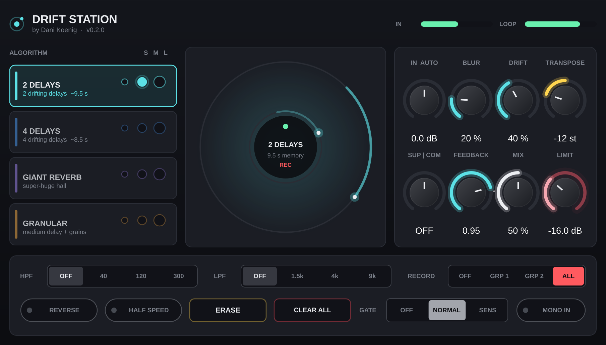

# Drift Station

Free drifting memory processor (VST3 / AU / Standalone) by Dani Koenig.
A standalone audio effect for evolving drones and soundscapes.



Drift Station records whatever you feed it into a large sound memory and keeps recombining it.
The delay lines all have different prime-number lengths, an asynchronous LFO moves them, and a slow
chaotic signal modulates that LFO. So the material layers up endlessly, like a looper, but without
an obvious repeating loop. Made for ambient, drones and evolving soundscapes.

Inspired by the SOMA Laboratory COSMOS hardware pedal. Drift Station is an independent project and
not affiliated with SOMA Laboratory.

## Algorithms (each in 3 sizes)

| Algorithm    | S             | M                  | L                         |
|--------------|---------------|--------------------|---------------------------|
| 2 Delays     | ~2.5 s        | ~9.5 s             | ~22 s                     |
| 4 Delays     | ~2.5 s        | ~8.5 s             | ~11.5 s                   |
| Giant Reverb | huge hall     | super-huge hall    | insanely-super-huge hall  |
| Granular     | small grains  | medium grains      | large + centre grain delay|

In the background the memory output slowly sways between left and right (periods of 83 s and 131 s), like the hardware.
The window opens at 100 % and can be resized freely (drag the bottom right corner, 70 % to 200 %).

All algorithms share one memory. When you switch, the content is kept and processed by the new algorithm.

## Controls

- **In (Auto)**: auto gain on the input. Every source is brought to a good working level, loud signals are pulled down, quiet ones lifted. The knob trims the target by +/-12 dB
- **Blur**: delays: cross-feedback between the lines. Granular: noise on the grain position
- **Drift**: delays: chaotic LFO moves the lines in the stereo field, each line stays on its side so the pitch stays steady. Granular: moves the grain positions
- **Transpose**: transposes the memory output in semitones. Centre = 0, left down to -24, right up to +12
- **Sup | Com**: left = suppressor (new sounds push out the recorded ones), right = compressor
- **Feedback**: 0 to 1.25, white tick = 1.0. A soft tape-style limiter prevents hard clipping
- **Limiter**: output limiter with auto gain, ceiling -1 dBFS. Fully open = only catches peaks. Turn it back to lower the threshold, the ring lights up red with the gain reduction
- **Mix** (far right): input vs. memory, centre = equal. Turn it to the centre to play live over your drone
- **HPF / LPF**: filters in the loop, 3 settings each
- **Record**: Off / Group 1 (left input) / Group 2 (right input) / All
- **Reverse**, **Half Speed** (delays), **Erase** (hold), **Clear All**
- **Gate** (input noise gate), **Mono In**

## Install

Download the latest release: https://github.com/danikoenig/DriftStation/releases
See `INSTALL.txt` (English / Deutsch). Apple Silicon, macOS 11+.

## Build

```
cmake -B build -DCMAKE_BUILD_TYPE=Release
cmake --build build --config Release
```

JUCE 8 is downloaded automatically. Engine test without JUCE:

```
g++ -O2 -std=c++17 -I Source tests/EngineTest.cpp Source/DriftEngine.cpp -o enginetest && ./enginetest
g++ -O2 -std=c++17 -I Source tests/DynamicsTest.cpp -o dyntest && ./dyntest
```
